<h1 align="center">
  <a href="https://mitchtech.github.io/agent-johnny5/">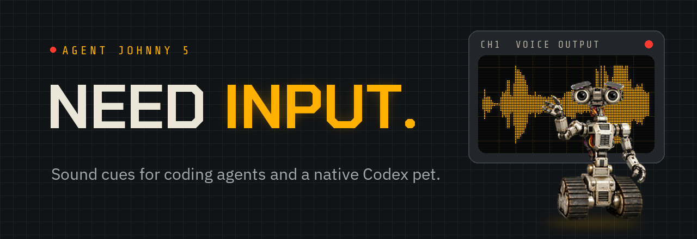</a>
</h1>

<p align="center">
  <a href="https://github.com/mitchtech/agent-johnny5/actions/workflows/check.yml"></a>
  <a href="https://github.com/mitchtech/agent-johnny5/releases/latest"></a>
  <a href="LICENSE"></a>
  <a href="pets/johnny5/LICENSE.txt"></a>
  <a href="audio/NOTICE.md"></a>
</p>

<p align="center"><b>Your coding agent says <i>Need input!</i> when it needs you.</b></p>

<p align="center">
  <a href="https://mitchtech.github.io/agent-johnny5/"><b>Hear every clip</b></a> ·
  <a href="#sounds">Event map</a> ·
  <a href="https://github.com/mitchtech/agent-johnny5/releases/latest/download/agent-johnny5-pet.zip">Download the Codex pet</a> ·
  <a href="https://github.com/mitchtech/agent-johnny5/releases">Releases</a> ·
  <a href="https://github.com/mitchtech/agent-navi">Sibling: Agent Navi</a> ·
  <a href="https://github.com/mitchtech/agent-warcraft">Sibling: Agent Warcraft</a> ·
  <a href="https://github.com/mitchtech/agent-starwars">Sibling: Agent Star Wars</a>
</p>

<table align="center">
  <tr>
    <td align="center">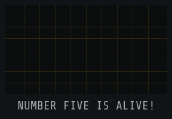<br><sub>Session start</sub></td>
    <td align="center">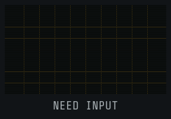<br><sub>Approval</sub></td>
    <td align="center">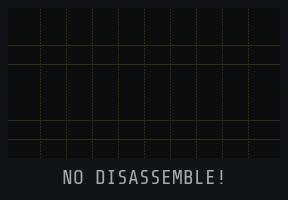<br><sub>Destructive command</sub></td>
    <td align="center">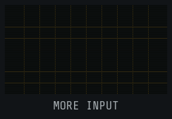<br><sub>Ready</sub></td>
    <td align="center">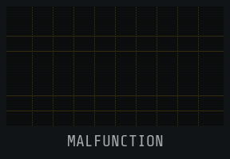<br><sub>Error</sub></td>
  </tr>
  <tr>
    <td align="center">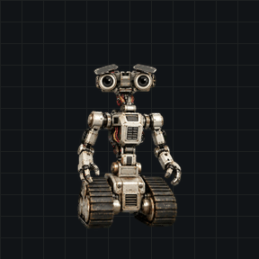<br><sub>Pet: waving</sub></td>
    <td align="center">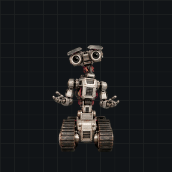<br><sub>Pet: waiting</sub></td>
    <td align="center">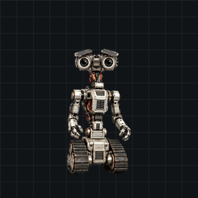<br><sub>Pet: blocked</sub></td>
    <td align="center">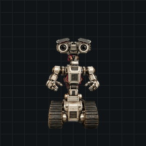<br><sub>Pet: working</sub></td>
    <td align="center">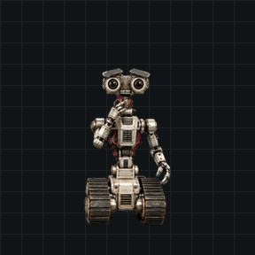<br><sub>Pet: review</sub></td>
  </tr>
</table>

Johnny 5 sound notifications for coding agents and an **independent Codex pet**.
Native sound integrations for **Claude Code**, **Codex**, and **Gemini CLI**, plus
a small event interface for other agents and scripts. One shared player supports
macOS, Linux, and Windows. The pet uses the host's native animation and activity states.

Agent Johnny 5 plays 20 lines from *Short Circuit* (1986): "Number five is
alive!" when a session starts, "Need input!" when an approval is waiting, and
"No disassemble, Number Five!" when that approval is for `rm -rf`, a force push,
or a dropped table. It runs locally, sends no telemetry, and never approves or
blocks an agent's actions. A sibling of [Agent Navi](https://github.com/mitchtech/agent-navi), [Agent Warcraft](https://github.com/mitchtech/agent-warcraft), and [Agent Star Wars](https://github.com/mitchtech/agent-starwars),
inspired by [thephw/claude-meseeks](https://github.com/thephw/claude-meseeks).

## Choose your setup

| Choice | Install | Requirements |
|---|---|---|
| Sounds | [Agent plugin](#install) or standalone CLI | Node.js 22+ and local audio |
| Codex pet | [Pet ZIP or CLI](#codex-pet) | A host with compatible custom pets; no Node.js needed for the ZIP |

Installing the sound plugin never installs or selects a pet. Installing the pet
never enables audio hooks or changes your sound settings. Take either, or both.

## Sound requirements

- **Node.js 22 or newer**, with `node` on the agent's `PATH`.
- **macOS:** built-in `afplay`.
- **Linux:** `paplay`, `pw-play`, `aplay`, or `ffplay`, with a working local audio device.
- **Windows:** Windows PowerShell (`powershell.exe`), using `System.Media.SoundPlayer`.

No npm runtime dependencies, Bash, or `jq` are required. Windows hooks and audio
playback do not require Git Bash. A headless machine without an audio device
cannot play sounds on your laptop automatically.

## Install

### Claude Code

```bash
claude plugin marketplace add mitchtech/agent-johnny5
claude plugin install johnny5@agent-johnny5
```

Inside a Claude Code session, the same steps are `/plugin marketplace add` and
`/plugin install`.

### Codex

```bash
codex plugin marketplace add mitchtech/agent-johnny5
codex plugin add johnny5@agent-johnny5
```

Review and trust the installed hooks in Codex's hook settings before using them.
Installing or enabling the plugin does not automatically trust its hook commands.
Restart the agent after installation or updates.

### Gemini CLI

```bash
gemini extensions install https://github.com/mitchtech/agent-johnny5
```

Gemini selects a self-contained ZIP for your platform from GitHub Releases.
Review the extension's hook consent prompt and restart Gemini. For local
development:

```bash
npm run gemini
gemini extensions link ./dist/gemini
```

The repository root is for shared sources and discovery; Gemini's executable
hook file is included in the generated extension, not the source root. Install
published release assets rather than linking the repository root or a raw Git
branch. See [Gemini integration](docs/gemini.md).

### Running alongside Agent Navi or Agent Warcraft

All four plugins respond to the same events. Enable one per host unless you
want a fairy, a robot, a peon, and two droids talking over each other: `claude plugin disable navi@agent-navi`
for Claude Code, or `enabled = false` under `[plugins."navi@agent-navi"]` in
`~/.codex/config.toml` for Codex.

### Local development

```bash
git clone https://github.com/mitchtech/agent-johnny5.git
cd agent-johnny5
node scripts/johnny5.mjs doctor
```

Use `claude plugin marketplace add /absolute/path/to/agent-johnny5` for Claude Code or
`codex plugin marketplace add /absolute/path/to/agent-johnny5` for Codex, followed by
the same plugin installation command above.

### Standalone command

For the `agent-johnny5` command outside an agent plugin:

```bash
npm install -g github:mitchtech/agent-johnny5
agent-johnny5 doctor
agent-johnny5 play approval_required --session my-session --tool Bash
agent-johnny5 preview need-input
```

All commands also work as `node /path/to/agent-johnny5/scripts/johnny5.mjs ...`.
Standalone `play` and `preview` wait for the short clip; native hooks dispatch
playback to a detached worker so the agent can continue immediately.

## Codex pet

<a href="assets/promotion/pet-preview.mp4">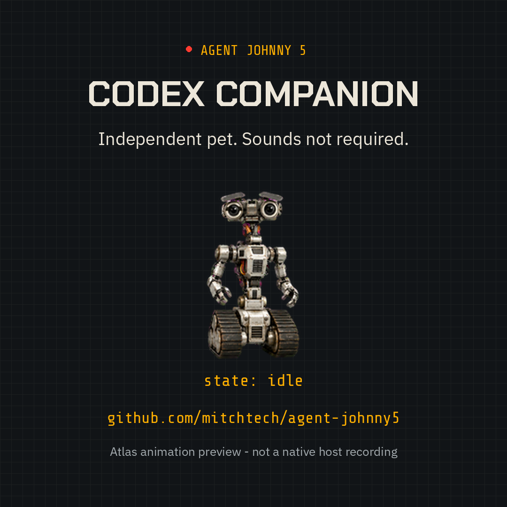</a>

The Johnny 5 pet has nine animations and sixteen look directions, with
binocular optics, expressive brow shutters, and tank treads. Codex drives its
animation from what the agent is doing. It installs independently from the
sounds. [Drive every animation on the site](https://mitchtech.github.io/agent-johnny5/#pet).

1. Download [agent-johnny5-pet.zip](https://github.com/mitchtech/agent-johnny5/releases/latest/download/agent-johnny5-pet.zip).
2. Extract its `johnny5` folder into `~/.codex/pets/`, or `pets/` inside your
   configured `CODEX_HOME`. Keep existing files if you already have a Johnny 5 pet.
3. Refresh the desktop pet picker and choose Johnny 5, or enter `/pets Johnny 5`
   in a supported Codex CLI terminal.

Or install with the CLI, which never changes your selected pet:

```bash
npm install -g github:mitchtech/agent-johnny5
agent-johnny5 pet install
agent-johnny5 doctor --pet
```

From a source checkout, use `node scripts/johnny5.mjs pet install`. Different
existing files require `pet install --replace`, which backs up the previous
folder; `agent-johnny5 pet uninstall` removes only an unchanged CLI-managed
installation. For a ChatGPT account pet, use the separate
[nine-row web atlas](https://github.com/mitchtech/agent-johnny5/releases/latest/download/agent-johnny5-pet-web.webp)
([upload guide](docs/pets.md#web-upload)). See [installation, compatibility, and
artwork provenance](docs/pets.md).

## Sounds

| Shared event | Sound | Default |
|---|---|---|
| `session_started` | Random "Number five is alive!" / "Hi" | On |
| `prompt_submitted` | Random "Input!" / "Yup" / "You got it" | On |
| `approval_required` | "Need input" | On |
| Approval for shell commands or file edits | "No disassemble?" | On |
| Approval for a destructive command | "No disassemble, Number Five!" | On |
| `input_required` | "I have questions" | On where available |
| `ready_for_input` | "More input" | On for Claude idle notifications |
| `turn_completed` | Random "Excellent" / "Pretty good" | Off |
| `error` | Random "Malfunction" / "Error" / "Uh oh" | Off |
| `context_compacting` | "Reassemble" | Off |
| `session_ended` | "Time's up" | Off |
| Easter egg | "Hey, laser lips...", "Nice software", or "Attractive" | 2% of session, prompt, ready, and completion cues |

**Destructive commands** are recognized from the approval request's command:
`rm` with recursive and force flags, `git push --force` or `-f` (not
`--force-with-lease`), `git reset --hard`, `git clean -f`, `DROP TABLE`/`DATABASE`/`SCHEMA`,
`TRUNCATE TABLE`, `mkfs`, `dd of=`, `chmod -R 777`, `Remove-Item -Recurse -Force`,
and `rmdir /s`. The alarm is a louder cue, not a safety check: it never blocks,
approves, or logs the command. Only a yes/no flag leaves the hook process.

**Easter eggs** never replace approval, question, error, or destructive-command
cues. Turn them off with `agent-johnny5 mute easter-egg`.

Subagent completion is silent. Idle/input notifications and completion events
are distinct; event availability depends on the host. See
[compatibility](docs/compatibility.md).

## Sound controls

```bash
agent-johnny5 status
agent-johnny5 mute prompt_submitted
agent-johnny5 unmute prompt_submitted
agent-johnny5 mute easter-egg
agent-johnny5 mute all
agent-johnny5 unmute all
agent-johnny5 preset attention
agent-johnny5 preset default
agent-johnny5 list
agent-johnny5 config --effective
```

Changes persist immediately and apply to the next hook, without restarting.
Global mute/unmute preserves individual event preferences. The attention preset
enables approval, question, and ready notifications while disabling session,
prompt, completion, error, compaction, and session-end cues. The default preset
restores event enablement without changing your custom clips, audio directory,
easter-egg setting, or global mute preference.

The bundled `johnny5-control` skill also handles requests such as "mute
Johnny 5", "turn off easter eggs", or "turn off prompt sounds" inside supported
agents. It uses the bundled CLI, so no global npm installation is needed.
`status --json` and `list --json` provide structured output. Status shows when
`AGENT_JOHNNY5_MUTE` overrides the saved global mute setting.

## Configuration

Configuration stays outside plugin caches, so updates preserve your settings:

- macOS/Linux: `~/.config/agent-johnny5/config.json`, or `$XDG_CONFIG_HOME/agent-johnny5/config.json`.
- Windows: `%APPDATA%/agent-johnny5/config.json`.

Create the parent directory and save the settings you want to override:

```json
{
  "muted": false,
  "audioDir": "./audio",
  "cooldownMs": 1000,
  "easterEgg": { "chance": 0.05, "clips": ["nice-software"] },
  "events": {
    "session_started": { "clips": ["alive"] },
    "approval_required": { "clips": ["need-input"], "changeClips": ["no-disassemble-q"], "dangerClips": ["no-disassemble-five"] },
    "turn_completed": { "enabled": true },
    "context_compacting": { "enabled": true }
  }
}
```

Omit `audioDir` to use bundled clips. Relative directories resolve from the
configuration file's directory. Custom audio directories must contain a
`<clip>.wav` for every name in `agent-johnny5 list`; use 16-bit PCM WAV for
compatibility with all players. Copy the clips to your own directory before
replacing them. Installed plugin files can be overwritten by updates.

An event's `clips` array selects one sound randomly; use one entry for a fixed
sound. `changeClips` applies to shell/file-change approvals and `dangerClips`
to destructive-command approvals, which take priority. `easterEgg.chance` is a
probability from 0 to 1. Each event accepts `enabled: false` to mute it
independently. `agent-johnny5 config` prints the complete default configuration
without writing anything.

| Environment variable | Effect |
|---|---|
| `AGENT_JOHNNY5_MUTE` | `1` mutes; `0` unmutes; overrides `muted` |
| `AGENT_JOHNNY5_CONFIG` | Explicit configuration file path |
| `AGENT_JOHNNY5_AUDIO_DIR` | Overrides the audio directory |
| `AGENT_JOHNNY5_STATE_DIR` | Overrides the local playback state directory |

Configure environment variables before starting the agent. Agent Johnny 5 suppresses
repeated events within `cooldownMs` for the same agent/session/event. A global
playback lock drops overlapping clips across sessions. Claude's delayed
permission notification is suppressed for at least 10 seconds after a matching
approval alert; a network permission notification without a preceding alert can
still play. State contains hashed event/session identifiers and timestamps only,
and inactive records are cleaned up after a day when another sound plays.

## Other agents

Call the shared interface when your agent emits an attention event:

```bash
agent-johnny5 play session_started --session example
agent-johnny5 play prompt_submitted --session example
agent-johnny5 play approval_required --session example --tool Bash --command "rm -rf build"
agent-johnny5 play input_required --session example
```

Completion, error, compaction, and session-end events honor their configuration
toggles. Integration scripts should treat playback failures as advisory. No
tool-call or transcript polling is needed.

## Troubleshooting

```bash
node scripts/johnny5.mjs doctor
node scripts/johnny5.mjs preview alive
```

`doctor` reports configuration, paths, player availability, clips, enabled
events, easter eggs, and the optional pet. `doctor --pet` checks only the pet and works
without an audio player or valid sound configuration. These commands operate
without playing anything. `preview` explicitly plays a clip even when
muted and bypasses event cooldown, but still respects overlap prevention. A busy
player is reported explicitly instead of silently skipping the preview. Neither command changes settings.

Native hooks exit successfully on malformed input, invalid configuration, missing
audio/player, or playback failure. They produce no prose or permission decisions.
Codex `Stop` and every Gemini hook emit only `{}` as neutral JSON required by those hosts. Run diagnostics
when sounds are missing, and check Node's availability and hook trust settings.

SSH, containers, WSL, and cloud sessions play on the machine executing the hook.
An audio bridge must already exist if you expect those sounds on another machine.
GitHub marketplace installation is the distribution path; this hook plugin is
not submitted to OpenAI's public plugin directory.

## Development

```bash
npm run check
npm test
npm run test:package
python3 -m pip install -r requirements-dev.txt
python3 scripts/build-audio.py --check
python3 scripts/check-pet.py
python3 scripts/build-assets.py
python3 scripts/package-release.py
npm run site
```

`scripts/export-pet-web.py` regenerates the web atlas after the pet art changes,
and `docs/promotion/build-media.py` rebuilds the captioned preview videos.

Tests simulate players and cover host payloads, destructive-command detection,
easter eggs, configuration, deduplication, overlap, failures, paths with spaces,
and packaging. CI runs Node 22 and 24 on macOS, Linux, and Windows. See
[compatibility](docs/compatibility.md) and [release notes](CHANGELOG.md).

Python/Pillow are development tools for audio provenance, asset validation, and
previews, not runtime dependencies. `build-audio.py` rebuilds the clips from
[their recorded sources](audio/sources.json) with ffmpeg; `--check` verifies the
committed files offline. See [distribution maintenance](docs/distribution.md)
for releases and the site, and [contributor instructions](CONTRIBUTING.md) for
the project workflow.

## Credits and license

- Author: [Michael J. Mitchell / mitchtech](https://github.com/mitchtech).
- Johnny 5, *Short Circuit* (1986): TriStar Pictures. Voice of Johnny 5: Tim Blaney.
- Clip sources: johnny5soundboard.com and the 101soundboards *Short Circuit* board.
- Pet artwork: Michael J. Mitchell / mitchtech, [CC BY 4.0](pets/johnny5/LICENSE.txt), with [provenance](pets/johnny5/NOTICE.md).
- Sibling projects: [Agent Navi](https://github.com/mitchtech/agent-navi), [Agent Warcraft](https://github.com/mitchtech/agent-warcraft), and [Agent Star Wars](https://github.com/mitchtech/agent-starwars).
- Original plugin inspiration: [thephw/claude-meseeks](https://github.com/thephw/claude-meseeks).

Code and configuration: [MIT](LICENSE). Contributor rights in the pet artwork:
[CC BY 4.0](pets/johnny5/LICENSE.txt). Bundled audio is excluded from both
licenses; see the [audio rights notice](audio/NOTICE.md). Third-party character
rights and trademarks remain with their owners. This project is not affiliated
with or endorsed by them.
